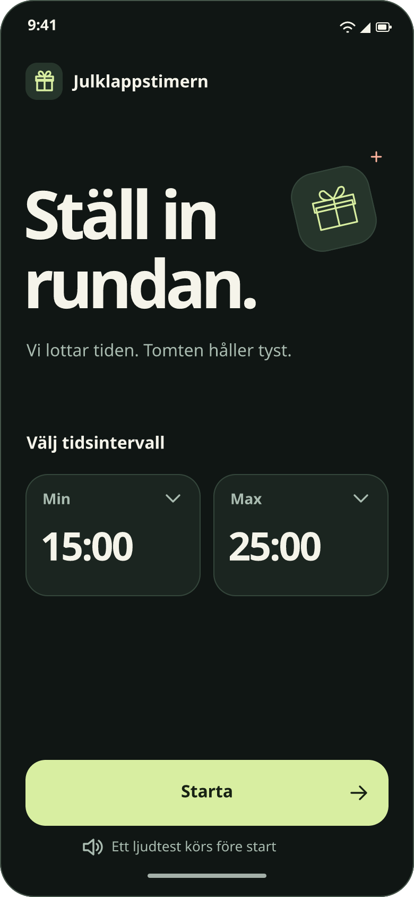
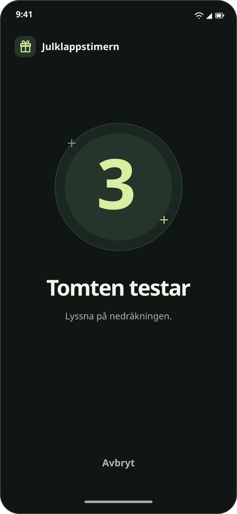
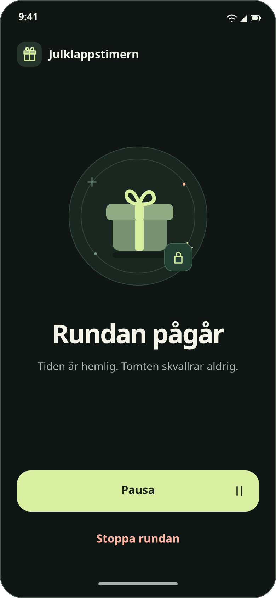
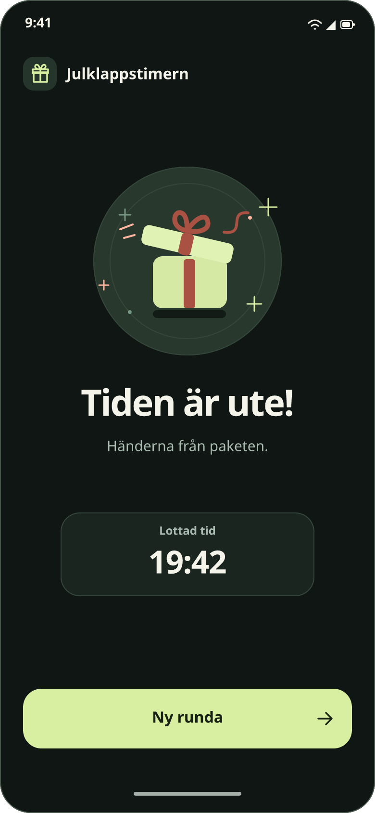

# Julklappstimern

En hemlig timer till julklappsspelet. Du bestämmer hur kort och lång rundan får vara. Tomten lottar tiden och håller den hemlig tills rundan är över.

## Installera

Julklappstimern fungerar på Android 8.0 eller senare. [Ladda ner APK-filen från GitHub](https://github.com/addestromberg/julklapps-timer/releases/latest), öppna den på telefonen och följ Androids installationssteg. Om Android ber om det, välj **Tillåt från den här källan** för appen som öppnar APK-filen. [Googles installationsguide](https://support.google.com/pixelphone/answer/7391672?hl=sv)

## Appen i bilder

| Ställ in rundan | Tomtens nedräkning |
| :---: | :---: |
|  |  |
| **Rundan pågår** | **Rundan är klar** |
|  |  |

*Vyer från FigCraft-prototypen.*

## Spela en runda

1. Tryck på **Min** och **Max** för att ställa in rundans längd. Du kan välja mellan 1 och 60 minuter i steg om 15 sekunder. Första gången är intervallet 15–25 minuter. Sedan kommer appen ihåg dina val.
2. Tryck på **Starta** och lyssna på tomtens nedräkning. När appen frågar **Hördes ljudet?**, tryck **Ja**. Ett pling hörs och rundan börjar.
3. Tryck **Pausa** om ni behöver en paus och **Fortsätt** när ni är redo. Om ni vill avsluta i förtid, tryck **Stoppa rundan** och bekräfta.
4. När tiden går ut spelas *Deck the Halls* på bjällror. Tryck **Tysta larm** i appen eller på larmnotisen. Den lottade tiden visas när rundan är slut eller har stoppats. Tryck **Ny runda** för att spela igen.

## Om larmet är tyst

Tillåt larmnotiser om Android frågar. Ljudtestet, plinget och slutlarmet använder telefonens **larmvolym**. Tryck **Nej** om du inte hör nedräkningen. Då kan du öppna ljudinställningarna, höja larmvolymen och testa igen. Om **Stör ej** är på, kontrollera att larm får höras. [Googles hjälp om larm](https://support.google.com/android/answer/2840926?hl=sv)

Bjällerklippet spelades in av Ihaksi och delas under CC0. [Freesound](https://freesound.org/people/Ihaksi/sounds/411420/)
